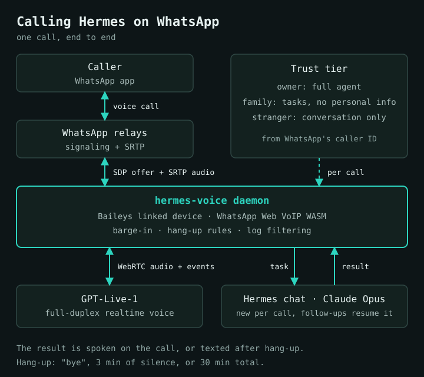

I can phone my AI agent. I open WhatsApp, call its number, and something answers within a couple of seconds. I talk, it talks back, and if I ask for real work it goes off and does it.

I built this because a phone call is the one interface everybody already knows. It works while I'm driving or walking, with no screen and no app to open. My family can use it too, without installing anything or learning a command.

The agent is [Hermes](https://github.com/NousResearch/hermes-agent), NousResearch's open-source agent, which I run on my own machine with Claude Opus as its brain. This post covers how the call path works, the bugs that cost me the most time, and the risks I'm carrying.

## The shape of it



There are four moving parts.

**A linked device.** The agent has its own WhatsApp number. A small Node daemon registers as a linked device of that number, the same mechanism WhatsApp Web uses, through [Baileys](https://github.com/WhiskeySockets/Baileys). It holds a socket open and sees every incoming call stanza.

**WhatsApp Web's own VoIP stack.** Baileys handles messaging but not calls. WhatsApp Web ships its calling engine as a WebAssembly module, so the daemon loads that module and feeds it signaling. It negotiates the call, exchanges SDP, and gives me decoded 16 kHz PCM from the SRTP stream. In the other direction I push PCM in and the module encodes it. I am not reimplementing a codec. I'm hosting WhatsApp's own.

**A realtime voice model.** The moment the call is accepted, the daemon opens a WebRTC session to GPT-Live-1, a full-duplex speech model. I reach it through the Codex Live lane of my voice plugin, which already carries my persona and memory snapshot for the desktop microphone. Caller audio goes up, the model's audio track is resampled from 48 kHz to 16 kHz and goes back down the call. A phone call behaves like the desktop mic because it is the same lane.

**Delegation.** The voice model is quick and chatty, but it isn't the agent. When I ask for something that needs tools, it emits a delegation. The daemon turns that into a Hermes chat, via `hermes chat --format stream-json`. Each call gets a new chat, titled with the call, pinned to Claude Opus. Follow-ups within the same call resume that chat, so "and do the same for the other one" works. Hermes streams its result back and the voice speaks it. If I hang up before it finishes, the result arrives as a WhatsApp text.

A call ends when the caller says "bye", after three minutes of silence, or at thirty minutes total. The silence and total limits exist because a forgotten call is billed realtime voice minutes.

On my numbers: across the delegations I could pair up in my logs, the median time from the voice handing off a task to the result coming back was about 15 seconds, with the slowest tenth around 20. Real calls have run from two minutes to about fifteen. These are aggregates from my own use, not a benchmark.

## Who gets what

Anyone can call the number, so identity matters more than the voice does. The daemon answers everyone, then decides what they get from the caller ID WhatsApp itself reports:

| Tier | Who | What they get |
|---|---|---|
| Verified | Me, my wife | The full agent, with memory |
| Known | My dad | Tasks, but no personal information, and a persona without my memory. Greeted in Hindi. |
| Stranger | Everyone else | Conversation only. No tasks. I get the transcript as a text afterwards. |

The caller list is a small JSON file read at startup. The part that matters most is what happens downstream.

Delegated chats run as CLI sessions, and my agent's system prompt treats CLI sessions as me. Left alone, a task spawned by a stranger's call would be executed as if I had typed it. So every delegated prompt states the real caller identity and whether that person may receive personal information. Strangers don't get delegation at all, and I wouldn't turn that on. The check is in the daemon, so the voice model can't talk its way past it.

## The bugs that hurt

### The call-creator rewrite

My first real incoming call did nothing. The offer arrived, the daemon logged it, and the WASM silently dropped it with "mismatched peer id and creator id".

WhatsApp now identifies many users by a LID rather than a phone number. The offer carried `call-creator="<lid>@lid"`. When that bare string is re-encoded into a binary JID pair, the WASM reads it as a `s.whatsapp.net` address, which then disagrees with the `from` attribute. The fix is to rewrite the attribute into the device form, `<lid>:<device>@lid`, before handing the stanza over:

```ts
// A bare "<lid>@lid" call-creator re-encodes as a JID pair the WASM reads as
// s.whatsapp.net, so it drops the stanza. The device form re-encodes correctly.
const aligned = `${user}:${device}@lid`;
if (creator !== aligned) child.attrs["call-creator"] = aligned;
```

Two lines of effect. The only clue was that one line from the WASM, and it only shows up with debug logging on.

### Event 2 is not a hang-up

The WASM reports lifecycle events as small integers. I had assumed event 2 meant the remote side ended the call, which seemed natural, and handled it by tearing everything down. Incoming calls then died the instant they started.

Event 2 means "offer received". It fires at the beginning, not the end. Outbound calls never showed it, so my first tests passed. The lesson there was cheap: when you're mapping an undocumented enum, log the whole sequence on both call directions before you act on any single value.

### The log that leaks keys

While debugging, I noticed `Closing session: ...` blocks in my terminal. libsignal prints the whole session entry on `console.log` and `console.info`, and that entry includes private key material. Anyone who saw those logs, or any paste of them, would hold secrets that identify my linked device.

The fix is a small wrapper around `console.log` and `console.info` that drops lines matching libsignal's session messages before they are written, in both the daemon and the CLI script. It's boring, and I'd rather have found it on day two than after pasting a log into a chat. My rule now is that raw output from this stack is never pasted anywhere.

### Barge-in without interrupt

I wanted to be able to talk over the agent mid-sentence, as you would on any call. My first design called `turn/interrupt` on the realtime session. The server rejected it every time: realtime turn ids aren't the ids that call expects, and it answers "expected active turn id".

What works is dealing with it locally. The daemon tracks when the model's audio is playing and measures the RMS energy of the caller's audio. If the caller stays loud for about 240 ms while the bot is speaking, it flushes the queued reply audio from the uplink. The caller hears silence almost at once and the model hears the interruption in its input stream, so it stops on its own, at least in practice. I still send the interrupt, but I don't depend on it.

It is a heuristic with a tunable threshold, and it gets noisy in a car with the window down.

## Limits and risks

I don't want to oversell this.

- **It is an unofficial protocol.** I'm driving WhatsApp Web's calling code outside a browser. A WhatsApp Web update can break it with no notice, and I have no support channel.
- **Ban risk is real.** Automated use of a consumer account violates the terms. I use a dedicated number, keep volume low and only talk to people I know. That lowers the risk without removing it.
- **One call at a time.** The daemon owns one linked-device session and one voice lane. A second caller gets a busy signal. Running two daemons on one session logs both off, so I don't.
- **Voice costs money.** Realtime audio is the expensive part, which is why the silence and total-time limits exist. I run it on a ChatGPT plan's quota rather than per-minute API billing, and I watch it.
- **Privacy.** Audio goes to a model provider. Strangers' conversations are summarised to me, and I treat that as part of the deal for anyone who calls.
- **It is a personal tool.** I wouldn't put this in front of customers.

The code is open source at [ajaygahlot8/hermes-whatsapp-voice](https://github.com/ajaygahlot8/hermes-whatsapp-voice), with setup steps and the same warnings.

## What I learnt

1. **Identity is the product.** The voice is the easy part. Deciding who is calling and what they may touch took more design than audio did, and a prompt that says "be careful" is no substitute for a check in code.
2. **Delegate, don't fuse.** A fast voice model plus a slow, capable agent beats one model trying to be both. The voice buys time with small talk while Opus works, and the seam between them is a plain text task and a plain text result.
3. **Fresh context per call.** A new chat for each call keeps one conversation from leaking into the next, and the title makes it easy to audit afterwards.
4. **Undocumented stacks need event logs, not guesses.** The LID rewrite and event 2 both came down to reading what the WASM said instead of what I assumed it meant.
5. **Treat library logs as hostile.** Anything that touches crypto can print secrets. Filter first, then debug.
6. **Make cost limits boring and automatic.** Silence timeouts and a hard cap cost almost nothing to build. Forgetting them would be expensive.
7. **Say the risk out loud.** I'd rather run this knowing it can break or get banned than pretend it's infrastructure.

The most useful thing about a phone is that it is already in my hand. Now my agent is a contact in it.
